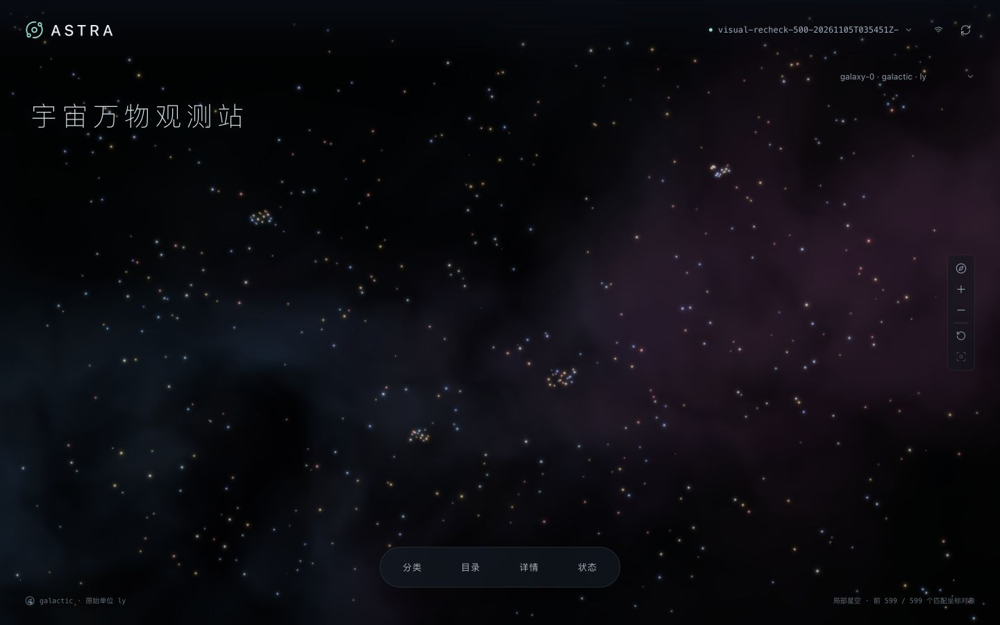

# ASTRA 宇宙万物观测站 · 题目二

ASTRA 持续接收发生器推送的观测数据，保存对象和分类信息，并提供星空浏览、筛选、详情查询和 NDJSON 流式导出。

技术栈：**FastAPI + SQLite WAL/FULL + React/TypeScript + Three.js**。前后端由一个应用容器提供服务，发生器单独运行。

[源码仓库](https://github.com/txxxxz/astra-observatory) · [协议与应用详细说明](observatory/README.md)



## 1. 从仓库启动

需要 Git、Python 3.12+、支持 **Linux arm64** 容器的 Docker Engine / Docker Desktop 和 Docker Compose。首次构建和下载发生器需要联网，完成后可在本地运行。

```bash
git clone https://github.com/txxxxz/astra-observatory.git
cd astra-observatory
cd observatory

# 下载公开题包，验证发生器镜像 tar 的 SHA-256，再导入 Docker
python3 scripts/prepare_generator.py

# 同时启动应用与独立发生器
docker compose --profile generator up -d --build

# 期望 status=ok、SQLite=3.51.3、journal_mode=wal、synchronous_name=FULL
curl -fsS http://127.0.0.1:8000/api/health
```

已有题包时，第一步可改为 `python3 scripts/prepare_generator.py --image-tar /absolute/path/flightgen-image.tar`，或使用 `--archive /absolute/path/candidate-package.zip`。

打开 [观测站](http://127.0.0.1:8000/)；[API 文档](http://127.0.0.1:8000/docs) 同源提供。应用端口默认 8000、发生器端口 9001，均只监听 localhost。端口冲突时可设置 `OBS_PORT` / `GENERATOR_PORT`；对应脚本的 `--base-url` / `--generator-url` 也需要匹配。

## 2. 使用系统与接入数据

发生器通过 HTTP POST 向 `/ingest` 推送数据，应用提交数据库事务后返回确认。网页用于查询和探索已保存的数据；发生器测试由命令单独启动。首次使用可先导入仓库中的协议样本：

```bash
# 仍在 observatory/ 目录；这一命令无需启动发生器负载
python3 scripts/replay_samples.py --output evidence/sample-replay-local.json
```

首次导入会创建 `attachment-probe-001` 运行，包含 2,080 个有效对象。重复执行会触发去重；需要独立运行时，可增加 `--test-id sample-new-001`。

体验持续输入和查询，可运行：

```bash
# 目标每秒500对象，持续60秒；同时浏览、读详情与流式导出
python3 scripts/benchmark.py --rates 500 --seconds 60 --readers 2 \
  --containers astra-observatory-app-1 astra-observatory-generator-1
```

脚本自动生成独立 `test_id`，报告保存到 `evidence/benchmarks/`。同一时间只运行一个发生器任务。也可直接调用发生器 `/start`、`/status`、`/receipt`；完整请求见 [接入操作](observatory/README.md#先体验再接入新数据)。

界面操作路径：

1. 顶部选择运行和坐标系；不同 `frame_id / frame_kind / unit` 不混绘。
2. 默认按屏幕宽高铺开星点；拖动旋转、滚轮缩放，点击星点读取对应对象。
3. 底部“分类 / 目录 / 详情 / 状态”按需展开。目录支持分类及后代、名称前缀、对象 ID、分页和导出；无坐标对象也可浏览。
4. “聚焦此对象”拉近镜头，随后变为“回到原处”；返回时恢复此前视角，详情卡保持展开。
5. 持续写入时统计自动更新，点击“全站新增”提示更新星空与目录，避免正在阅读的列表不断跳动。

星空布局会拉近星群、增强纵深，并适应屏幕比例，每个可选星点仍对应一个真实对象。详情与导出保留原始 XYZ；空间测量应使用这些原始坐标。星点颜色、光晕和背景星云用于视觉展示。

## 3. 运行与验收

以下命令均在 `observatory/` 执行：

```bash
# 自动化正确性测试（无需运行发生器）
python3 -m venv .venv
. .venv/bin/activate
pip install -r requirements-dev.txt
PYTHONPATH=. pytest tests -q

# 两档真实混合压力：持续写入 + 查询 + 导出
python3 scripts/benchmark.py --rates 500 3000 --seconds 60 --readers 2 \
  --containers astra-observatory-app-1 astra-observatory-generator-1

# 在发生器已停止后执行：SIGKILL应用，再逐项核对已确认数据
python3 scripts/verify_recovery.py
```

验收检查四项结果：自动化测试通过、样本导入状态符合预期、压测报告 `errors` 为空且导出数量一致、重启后已确认消息及对象完整保留。压测报告分别记录目标速率和实测吞吐，并提供查询 p50/p95/p99、失败次数、首条导出记录的响应时间、完整导出耗时和资源使用量。

手动验收分类筛选、目录翻页、星点选择、聚焦/返回、原始属性、坐标系切换和 NDJSON 下载。本地前端测试需要 Node.js 22 和 npm：

```bash
cd frontend
npm ci
node --test tests/starLayout.test.mjs
npm run build
cd ..
```

布局测试覆盖 599 / 3,000 个点在宽屏和窄屏中的分布、原始坐标保留，以及空数据和单点情况。本地构建用于检查代码；更新容器中的页面请在 `observatory/` 执行 `docker compose up -d --build app`。

## 4. 实际测试结果

测试日期：2026-11-05；平台：Linux arm64；输入来自题包发生器。

本轮在 **4 vCPU / 4 GiB** 应用容器、独立 **1 vCPU / 256 MiB** 发生器下逐档升压，使用 4 个并发查询客户端模拟浏览操作，同时查询列表、详情、分类和点云，并定期导出。SQLite 使用 WAL 和 `synchronous=FULL`，事务提交后返回成功。

| 每批对象数 | 发送并发数 | 时长 | 实际入库对象/秒 | 列表 p99 | 点云 p99 | HTTP 429 |
|---:|---:|---:|---:|---:|---:|---:|
| 500 | 4 | 60 秒 | 7,925 | 43 ms | 207 ms | 0 |
| 1,000 | 4 | 60 秒 | 9,733 | 69 ms | 480 ms | 0 |
| 1,000 | 10 | 30 秒 | 10,066 | 153 ms | 492 ms | 973 |

**未触发接收限流的配置中，每批 1,000 个对象、4 个发送并发的吞吐最高，实际入库约 9,733 对象/秒。** 并发数增加到 10 后，吞吐只提高 3.4%，318 批数据在重试后仍未获确认，接收端返回 973 次 HTTP 429（请求过多）。本次测试中，吞吐接近每秒 1 万对象后，继续增加并发收益有限。每批 500 个对象、4 个发送并发时，查询响应更快，适合边接收数据边浏览。

各档查询和导出均成功，最终导出数量与数据库一致。压测后数据库累计保存 **2,447,800 个对象**，数据目录约 **9.2 GiB**，应用容器内存峰值约 **535 MiB**。发生器每 20 批更新一次分类，因此增大批次也会减少每个对象对应的分类更新开销。各档完整参数、确认数量、资源记录和原始报告见 [吞吐与过载测试](observatory/docs/capacity-ceiling.md)。

此前的三档基础测试共入库 468,700 个对象，完成查询、导出及 4,685 个已确认批次的内容核对。应用通过了强制停止后的数据恢复测试。新版测试脚本还完成一次 20 秒验证：两个并发查询客户端、8,300 个对象、3 次并发导出，最终数量匹配。

自动化测试 **37 项通过**（33 项后端、4 项压测脚本），另有 **3 项前端布局测试通过**。布局测试覆盖 599 / 3,000 个点、宽窄屏、空数据及同坐标对象的排列；浏览器验证了点选、聚焦、返回和详情展示。

| 记录 | 内容 |
|---|---|
| [吞吐与过载测试](observatory/docs/capacity-ceiling.md) | 逐档升压、限流、查询延迟、资源占用与复现命令 |
| [基础测试](observatory/docs/benchmark.md) | 最初三档混合负载结果 |
| [确认消息核对](observatory/evidence/receipt-audit.json) / [恢复记录](observatory/evidence/recovery.json) | 已确认消息及进程崩溃恢复 |
| [资源与界面验证](observatory/docs/validation.md) | 容器配置、只读根文件系统、前端交互 |

## 5. 架构设计与取舍

| 取舍 | 实现与原因 |
|---|---|
| 一个后台应用 + SQLite | 减少后台组件数量；单个写入锁控制事务，限制并发请求，WAL 支持读写并行 |
| 事务提交后返回 2xx | 在同一事务中保存原始消息、对象状态和处理结果，保证确认的数据已持久化 |
| 完整保留 JSON + 索引字段 | 保留新属性和嵌套数据，为分类、ID、名称和坐标查询建立索引 |
| 限制显示数量，按块导出 | 界面默认最多显示 3,000 个点，列表分页、详情按需读取，完整结果分块输出 |
| 展示布局与原始坐标分离 | 星空布局适应交互浏览，详情与导出保留原始 XYZ |

应用容器限制为 **4 vCPU / 4 GiB**，发生器单独限制为 **1 vCPU / 256 MiB**，均不使用额外 swap。实际配置见 [compose.yaml](observatory/compose.yaml) 与 [运行核查](observatory/evidence/runtime-budget-recheck.json)。应用根文件系统只读，`/tmp` 为 64 MiB tmpfs（计入内存）。

整体磁盘预算为 **20 GiB**，数据目录的容量阈值设为 **18 GiB（软限制）**。检查范围包括 DB、WAL、SHM 和应用日志；接近阈值时停止接收新数据，为镜像、Docker 日志和事务增长预留空间。日志定期轮转，历史数据由用户管理。

严格的磁盘上限需由部署平台的文件系统配额实现；普通 Docker 命名卷自身没有容量硬限制。

## 6. 当前限制

- 分类版本缺失时隔离整条消息；同一对象 ID 出现不同内容时隔离整个批次。状态面板提供原始消息和隔离原因，当前不自动合并对象更新。
- 星空显示最早匹配的有限数量对象，完整结果可通过分页和导出查看。
- SQLite 采用单写入设计。接收并发超过处理能力时返回 HTTP 429，发送端需按约定重试。
- 已完成的可靠性测试覆盖应用进程崩溃恢复；长时间稳定性、宿主断电和接近 20 GiB 容量的测试仍需补充。
- 默认用于本机访问，暂不提供用户认证与访问控制。

## 7. 停止与保留数据

```bash
# 若发生器仍在运行，先停止并等待 /status 返回 finished
curl -fsS -X POST http://127.0.0.1:9001/stop
# 保留数据卷；不加 -v
docker compose --profile generator down
```

常规停止保留命名数据卷；再次启动后可继续浏览已有运行。`docker compose down -v` 会删除数据卷与观测数据，不用于日常停止。
