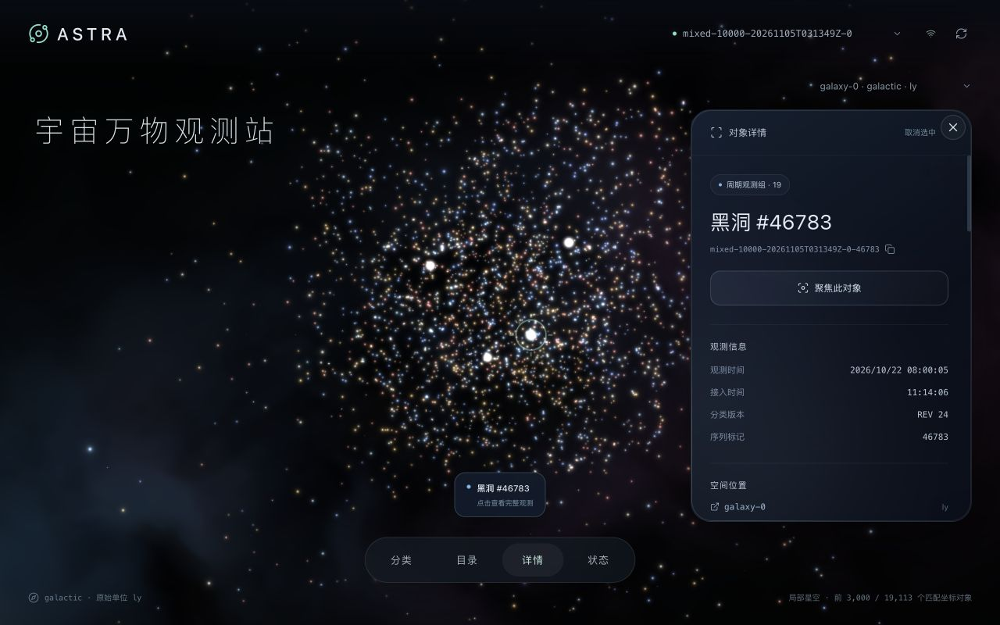

# 题目二 · ASTRA 宇宙万物观测站

一套持续接收真实发生器数据的探索工作台：可靠保存原始消息，按演化分类组织对象，在独立坐标系里交互探索，并完整导出筛选结果。

技术栈：**FastAPI · SQLite WAL/FULL · React / TypeScript / Vite · Three.js**。运行时一个应用容器，前后端同源；发生器独立运行。



[窄屏截图](evidence/screenshots/spotlight-mobile.jpg) · [浏览器操作验收](docs/browser-qa.md) · [本轮更新验收](docs/visual-resource-recheck.md) · [压测优化分析](docs/performance-review.md)

## 快速运行

需要 Docker Desktop（Linux arm64）以及 Python 3.12+。从本目录执行：

```bash
# 下载题目公开附件、校验发生器 tar 的 SHA-256、导入镜像
python3 scripts/prepare_generator.py

# 构建并启动：应用 4 vCPU / 4 GiB，发生器 1 vCPU / 256 MiB
docker compose --profile generator up -d --build

# 校验实际 SQLite、WAL、FULL 与健康状态
curl -fsS http://127.0.0.1:8000/api/health
```

打开 **http://127.0.0.1:8000**。API 文档位于 `/docs`。端口默认仅监听 localhost；可用 `OBS_PORT` 和 `GENERATOR_PORT` 改宿主端口，发生器在 Compose 内使用 `http://app:8000/ingest`。

已有题包时可跳过下载：

```bash
python3 scripts/prepare_generator.py --image-tar /absolute/path/flightgen-image.tar
# 或 --archive /absolute/path/candidate-package.zip
```

### 星空交互与测试数据

页面固定使用经过空间调整的展示布局：对当前采样点中的空间邻近区域压缩中心间距，展开局部星群，并将 Z 轴放大 8 倍，减少薄片和大片空隙。它是展示变换，不表示真实距离；页面不再提供比例切换按钮。对象详情与导出始终使用原始 XYZ，选点和聚焦跟随当前展示位置。暖黄、淡红、冰蓝等低饱和配色由对象 ID 稳定选择，亮核、光晕、轻微闪烁均为视觉效果，不代表测得的温度或亮度。远处装饰星空和缓慢流动的星云不参与点选；星云与星点共用 WebGL 上下文，以一层背景绘制呈现。

分类、目录、详情和状态默认收起；Spotlight 卡片使用柔光边缘、指针光照与克制的玻璃表面。点选／聚焦后详情保持展开，按钮变为“回到原处”，可平滑恢复聚焦前的镜头位置、朝向和缩放。

应用被动接收发生器向 `/ingest` 发送的数据。打开网页不会启动发生器；已结束的运行仍可浏览。启动下面的测试后，在页面顶部选择相应 `test_id`，打开“状态”观察对象数与接收速率；点击“全站新增”提示更新星空和目录。每次测试使用新的 `test_id`，以免与已有运行混淆。

### 先体验，再接入新数据

```bash
# 121 条真实原始样本，附带哈希校验；不是性能测试
python3 scripts/replay_samples.py --output evidence/sample-replay.json

# 每次更换 test_id；发生器发送真实 evolving 数据
curl -fsS http://127.0.0.1:9001/start \
  -H 'Content-Type: application/json' \
  -d '{"workload":"objects","target_url":"http://app:8000/ingest","test_id":"demo-001","seed":42,"batch_size":100,"workers":4,"objects_per_second":500,"rate_profile":"bursty","ramp_seconds":5,"duration_seconds":60,"max_batches":20000,"retries":2,"objects":{"scenario":"evolving","tree_every_batches":20}}'

curl -fsS http://127.0.0.1:9001/status
# 外层 state=finished 后才能取得 receipt
curl -fsS http://127.0.0.1:9001/receipt
```

界面路径：**选择运行 → 分类及后代筛选 → 名称前缀或对象 ID → 点选／列表定位 → 完整详情 → NDJSON 导出**。坐标系筛选可同时作用于目录与导出，无坐标对象也能浏览。统计自动更新，目录和点云通过“新对象可查看”按钮刷新，保留用户阅读位置。接入状态窗口显示隔离原因与原始消息。

## 正确性与数据口径

- **commit 后才确认**：原始消息、处理状态、去重信息和业务投影在一个 SQLite 事务中保存，`synchronous=FULL`，之后返回 2xx。事务失败、空间不足、过载或请求超限返回非 2xx。
- **整批隔离**：已完整保存但不合法的批次返回 `quarantined`，任何正常对象也不会部分入库。冲突消息保存原文并标为 `conflict`。这类 2xx 表示可靠保存，不表示有效对象全部入库。
- **消息与对象分开**：消息用 `test_id + kind + batch/revision + canonical JSON SHA-256` 判断重复；同键不同内容记录冲突。对象按 `test_id + id` 唯一。不同消息内出现同一内容的对象不会重复计数。
- **不猜更新规则**：同 ID 不同内容的对象使整批隔离；`sequence` 不当作版本号。输入中的未知字段、嵌套 JSON、字符串／数字／null 均完整保留。详情使用 `{object, meta}` 信封，系统元数据不覆盖原始字段。
- **分类演化**：支持实际观察到的 create、rename、move；连续 revision、父节点和环路校验，缺口明确隔离，不自动重放。当前树用于当前筛选，历史 tree_revision 保存在对象与原始消息。
- **完整输出**：游标分页；导出冻结开始时的最大对象行号及分类后代集合。分块最多 200 行、约 1 MiB，单个大对象单独输出且受 8 MiB 接入上限约束。连接在每块读取后关闭，不让慢下载钉住 WAL。

| 指标 | 定义 |
|---|---|
| object_count / applied_objects | 当前运行中实际插入的不同对象数 |
| message_count | 唯一规范化消息数，包括隔离与冲突 |
| duplicate_count | 同消息同内容的额外投递次数 |
| received_objects | 唯一消息中对象条目总数，包括未应用条目 |
| 有效入库速率 | 最近 10 秒实际新增对象数 / 10 |
| backlog | 同步投影无确认后队列，固定为 0；未确认在途请求由发生器记录 |

## 资源与容量边界

Compose 强制应用 4 vCPU / 4 GiB、发生器 1 vCPU / 256 MiB，禁用额外 swap。应用与发生器 Docker 日志轮转，应用日志也轮转。数据卷内 DB、WAL、SHM 和应用日志一起计入软水位；默认 **18 GiB**，为 20 GiB 总预算预留镜像、事务与 Docker 日志余量。应用根文件系统只读，`/tmp` 使用上限 64 MiB 的 tmpfs（计入内存限制），避免容器可写层无界增长。每次接入检查体积与剩余磁盘，默认不删除数据。

Docker volume 本身不提供 20 GiB 硬配额，软水位是应用控制，宿主总磁盘仍需运维监督。达到水位后新接入返回 503，应先归档再决定扩容；不要删除正在使用的 DB/WAL 文件。

其他边界：8 MiB 请求、8 路接入、2 路导出；列表最多 200 条，点云最多 5,000 点（界面 3,000）；最近 200 次运行、最多 10,000 个坐标框架、100,000 个分类、分类深度 128。运行 ID 不允许斜杠、反斜杠或单独的 `.` / `..`，非法值确认前拒绝。

镜像固定基础镜像 digest 和依赖锁；编译并校验 SQLite **3.51.3** 源码哈希，构建时检查 Python 实际链接版本。该版本包含 [SQLite 官方说明中的 WAL-reset 修复](https://www.sqlite.org/wal.html#walreset)。主机上的其他 SQLite 版本不参与容器运行。

## 自动化验收

```bash
# 本地正确性测试，不需要启动发生器
python3 -m venv .venv
. .venv/bin/activate
pip install -r requirements-dev.txt
PYTHONPATH=. pytest tests -q

# 真实发生器两档混合负载：同时列表、详情、指标与全量流式导出
python3 scripts/benchmark.py --rates 500 3000 --seconds 60 \
  --containers astra-observatory-app-1 astra-observatory-generator-1

# SIGKILL 后逐条核对已确认消息、内容哈希和完整对象；不删除数据卷
python3 scripts/verify_recovery.py
```

每轮负载使用新的 test_id，输出原始发生器收据、目标参数、实测确认速率、有效对象数、查询 p50/p95、并发导出次数和数量、CPU/内存及磁盘采样。`objects_per_second=0` 表示尽力发送，**不是暂停**。脚本报告里的确认速率来自发生器收据，不使用目标速率冒充测量结果。

## 实测结果

2026-11-05 在实际 Linux arm64 容器内完成三档真实发生器混合负载：

| 目标对象/s | 时长s | 实际确认/s | 有效对象 | 列表p95 ms | 详情p95 ms | 最终导出s | 应用峰值MiB |
|---:|---:|---:|---:|---:|---:|---:|---:|
| 500 | 60 | 464.97 | 27,900 | 9.03 | 5.27 | 0.275 | 51.55 |
| 3,000 | 60 | 1,734.96 | 104,200 | 13.77 | 7.90 | 1.111 | 77.90 |
| 10,000 | 120 | 2,804.14 | 336,600 | 17.62 | 13.87 | 4.148 | 169.40 |

三档共 **468,700 个有效对象**，查询／导出探针 **0 错误**，三次最终导出计数均一致。最高档导出约 500 MB 完整 JSON，用时 4.15 秒；数据目录累计约 1.76 GiB。最高档有效入库约 2,805 对象/秒，未达到 10,000 目标，尚未证明系统上限。

**33 项自动化测试通过**，并在修复版 SQLite 的 arm64 镜像内复验。121 条协议样本得到 2,080 个对象、revision 11、4 次重复、2 条隔离、117 条唯一消息。SIGKILL 后21条已确认消息及20个完整对象逐字段复核通过。

确认与入库口径：第二、三档各有100个对象在发生器停止时已提交但响应中断，因此共确认468,500、实际入库468,700。全部4,685个已确认批次逐位对账通过；没有把未获确认的数据算作发生器成功确认。详见 [实测说明](docs/benchmark.md)、[紧凑摘要](evidence/benchmark-summary.json)、[收据对账](evidence/receipt-audit.json) 和 [恢复证据](evidence/recovery.json)。

## 本地前端开发

推荐后端仍使用上述容器，以获得同一修复版 SQLite。在 `frontend/` 执行：

```bash
npm ci
npm run dev
# Vite 将 /api 与 /ingest 代理到 localhost:8000
```

生产前端：`npm run build`，由 FastAPI 提供 `frontend/dist`。若本地运行后端，使用 `uvicorn backend.app:app --host 127.0.0.1 --port 8000 --workers 1`，并自行确认 SQLite 是已修复的版本；正式验收以容器为准。

## 目录与关键取舍

```text
backend/       原子接入、SQLite 投影、查询及有界流式导出
frontend/      React 工作台、Three.js 单框架点云
scripts/       发生器准备、样本回放、混合负载、崩溃恢复
tests/        正确性与边界用例、压缩原始样本（约 404 KiB）
evidence/      真实测试收据、资源记录与截图
docs/          API、设计、独立审查与面试说明
```

详细解释见 [设计](docs/design.md)、[API 契约](docs/API.md)、[面试说明](docs/interview-notes.md) 和 [审查记录](docs/review.md)。

当前采用单写事务，未引入持久队列、缓存或搜索服务；异常和未知更新规则可见且不自动猜测修复。点云取最早匹配的有界样本，**不代表全量随机分布**；不同 frame/unit 永不混绘，背景星空仅为装饰。没有账号系统，服务默认只暴露本机；不含云部署、历史回放、任意 JSON 全文索引。

进程崩溃测试不等于宿主断电保证。短测不能证明长时间稳态、百万对象或 20 GiB 满容量表现；性能报告只适用于记录的规模和环境。

## 停止与保留数据

```bash
# 发生器若仍在运行，先请求停止并等待 finished
curl -fsS -X POST http://127.0.0.1:9001/stop
# 停止并移除容器，保留命名数据卷
docker compose --profile generator down
```

`docker compose down -v` 会删除持久卷及全部观测数据；常规停止不使用 `-v`。源码仓库不包含数据库、镜像 tar、node_modules 或运行中的数据卷。

提交中的大型原始负载报告使用 `.json.gz` 无损压缩（SHA-256 见 `evidence/benchmark-archive-manifest.json`）；对账和汇总脚本直接支持压缩文件，复跑负载会生成普通 JSON。
