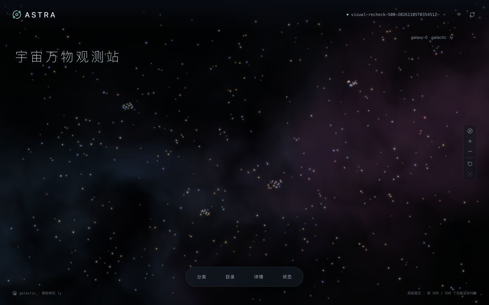

# ASTRA 宇宙万物观测站 · 应用详细说明

[系统概览与快速运行](../README.md)

ASTRA 接收发生器推送的观测数据，保存原始消息和对象状态，支持分类管理、交互星空、筛选查询与完整导出。

技术栈：**FastAPI · SQLite WAL/FULL · React / TypeScript / Vite · Three.js**。运行时一个应用容器，前后端同源；发生器独立运行。



[窄屏截图](evidence/screenshots/spotlight-mobile.jpg) · [功能与资源验收](docs/validation.md) · [吞吐与过载测试](docs/capacity-ceiling.md)

## 快速运行

需要支持 Linux arm64 容器的 Docker Engine / Docker Desktop、Docker Compose，以及 Python 3.12+。从本目录执行：

```bash
# 下载题目公开附件、校验发生器 tar 的 SHA-256、导入镜像
python3 scripts/prepare_generator.py

# 构建并启动：应用 4 vCPU / 4 GiB，发生器 1 vCPU / 256 MiB
docker compose --profile generator up -d --build

# 校验实际 SQLite、WAL、FULL 与健康状态
curl -fsS http://127.0.0.1:8000/api/health
```

打开 **http://127.0.0.1:8000**。API 文档位于 `/docs`。端口默认仅监听 localhost；可用 `OBS_PORT` 和 `GENERATOR_PORT` 改宿主端口，发生器在 Compose 内使用 `http://app:8000/ingest`。

已有题包时可跳过下载：

```bash
python3 scripts/prepare_generator.py --image-tar /absolute/path/flightgen-image.tar
# 或 --archive /absolute/path/candidate-package.zip
```

### 星空交互与测试数据

星空布局会拉近星群、增强纵深，并根据屏幕宽高铺开星点。每个可选星点对应一个对象；详情和导出保留原始 XYZ，空间测量应使用这些原始坐标。暖黄、淡红和冰蓝配色按对象 ID 稳定分配，光晕、闪烁和背景星云用于视觉展示。星云与星点共用 WebGL 上下文。

分类、目录、详情和状态默认收起，点击底栏入口展开。选择星点后显示详情；“聚焦此对象”拉近镜头，随后变为“回到原处”。返回时恢复此前的视角和缩放，详情保持展开。

发生器通过 HTTP POST 向 `/ingest` 推送数据。测试由命令启动，网页用于浏览已保存的数据。启动后，在顶部选择对应的 `test_id`，打开“状态”查看对象数和接收速率；点击“全站新增”提示更新星空与目录。每次测试使用独立的 `test_id`。

### 先体验，再接入新数据

```bash
# 导入121条协议样本，并校验文件哈希
python3 scripts/replay_samples.py --output evidence/sample-replay-local.json

# 每次更换 test_id；发生器发送真实 evolving 数据
curl -fsS http://127.0.0.1:9001/start \
  -H 'Content-Type: application/json' \
  -d '{"workload":"objects","target_url":"http://app:8000/ingest","test_id":"demo-001","seed":42,"batch_size":100,"workers":4,"objects_per_second":500,"rate_profile":"bursty","ramp_seconds":5,"duration_seconds":60,"max_batches":20000,"retries":2,"objects":{"scenario":"evolving","tree_every_batches":20}}'

curl -fsS http://127.0.0.1:9001/status
# 外层 state=finished 后才能取得 receipt
curl -fsS http://127.0.0.1:9001/receipt
```

界面路径：**选择运行 → 分类及后代筛选 → 名称前缀或对象 ID → 点选／列表定位 → 完整详情 → NDJSON 导出**。坐标系筛选可同时作用于目录与导出，无坐标对象也能浏览。统计自动更新，目录和点云通过“全站新增”提示刷新，保留用户阅读位置。接入状态窗口显示隔离原因与原始消息。

## 自动化验收

```bash
# 本地正确性测试，不需要启动发生器
python3 -m venv .venv
. .venv/bin/activate
pip install -r requirements-dev.txt
PYTHONPATH=. pytest tests -q

# 真实发生器两档混合负载：同时列表、详情、指标与全量流式导出
python3 scripts/benchmark.py --rates 500 3000 --seconds 60 \
  --containers astra-observatory-app-1 astra-observatory-generator-1

# SIGKILL 后逐条核对已确认消息、内容哈希和完整对象；不删除数据卷
python3 scripts/verify_recovery.py
```

每轮测试使用独立的 `test_id`，保存发生器收据、测试配置、实测吞吐、查询 p50/p95/p99、失败次数、导出响应时间和资源采样。查询覆盖列表、详情、点云、分类、坐标系及后代筛选。

`--readers` 设置模拟浏览的并发客户端数；`--no-exports` 关闭写入期间的导出，保留结束后的完整导出校验。`objects_per_second=0` 会以最快速度发送；停止测试使用 `/stop`。确认速率按发生器收据中的已确认对象数与运行时长计算。

## 实测结果

### 吞吐与过载测试

本轮在 **4 vCPU / 4 GiB** 应用容器、独立 **1 vCPU / 256 MiB** 发生器下逐档升压，使用 4 个并发查询客户端模拟浏览操作，同时查询列表、详情、分类和点云，并定期导出。SQLite 使用 WAL 和 `synchronous=FULL`，事务提交后返回成功。

| 每批对象数 | 发送并发数 | 时长 | 实际入库对象/秒 | 列表 p99 | 点云 p99 | HTTP 429 |
|---:|---:|---:|---:|---:|---:|---:|
| 500 | 4 | 60 秒 | 7,925 | 43 ms | 207 ms | 0 |
| 1,000 | 4 | 60 秒 | 9,733 | 69 ms | 480 ms | 0 |
| 1,000 | 10 | 30 秒 | 10,066 | 153 ms | 492 ms | 973 |

**未触发接收限流的配置中，每批 1,000 个对象、4 个发送并发的吞吐最高，实际入库约 9,733 对象/秒。** 并发数增加到 10 后，吞吐只提高 3.4%，318 批数据在重试后仍未获确认，接收端返回 973 次 HTTP 429（请求过多）。本次测试中，吞吐接近每秒 1 万对象后，继续增加并发收益有限。每批 500 个对象、4 个发送并发时，查询响应更快，适合边接收数据边浏览。

各档查询和导出均成功，最终导出数量与数据库一致。压测后数据库累计保存 **2,447,800 个对象**，数据目录约 **9.2 GiB**，应用容器内存峰值约 **535 MiB**。发生器每 20 批更新一次分类，因此增大批次也会减少每个对象对应的分类更新开销。各档完整参数、确认数量、资源记录和原始报告见 [吞吐与过载测试](docs/capacity-ceiling.md)。

### 基础负载测试

2026-11-05，在 Linux arm64 容器中运行题包发生器，完成以下三档测试。每档使用一个查询客户端，在持续写入期间查询列表、详情、指标并导出；详细配置见 [基础测试报告](docs/benchmark.md)。

| 目标对象/s | 时长s | 实际确认/s | 有效对象 | 列表p95 ms | 详情p95 ms | 最终导出s | 应用峰值MiB |
|---:|---:|---:|---:|---:|---:|---:|---:|
| 500 | 60 | 464.97 | 27,900 | 9.03 | 5.27 | 0.275 | 51.55 |
| 3,000 | 60 | 1,734.96 | 104,200 | 13.77 | 7.90 | 1.111 | 77.90 |
| 10,000 | 120 | 2,804.14 | 336,600 | 17.62 | 13.87 | 4.148 | 169.40 |

三档共入库 **468,700 个对象**，查询和导出均成功，最终导出数量全部匹配。最高档实际入库约 **2,805 对象/秒**，导出约 500 MB JSON 用时 4.15 秒；三档结束后数据目录约 1.76 GiB。

当前**37项自动化测试通过**（33项后端测试加4项压测脚本测试）。原33项后端测试曾在修复版SQLite的arm64镜像内复验；后续只读根部署后的121条样本重放全部识别为重复，见 [复验记录](docs/validation.md)。121 条协议样本得到 2,080 个对象、revision 11、4 次重复、2 条隔离、117 条唯一消息。SIGKILL 后21条已确认消息及20个完整对象逐字段复核通过。

确认数与入库数分别统计：第二、三档各有 100 个对象在发生器停止时已提交到数据库，但响应中断。因此发送端共确认 468,500 个对象，数据库入库 468,700 个。全部 4,685 个已确认批次核对通过。详见 [实测说明](docs/benchmark.md)、[测试摘要](evidence/benchmark-summary.json)、[收据对账](evidence/receipt-audit.json) 和 [恢复证据](evidence/recovery.json)。

### 并发查询与导出短时验证

新增点云、分类等查询后，运行了一次 20 秒测试：目标速率 500 对象/秒、两个并发查询客户端，入库 8,300 个对象，实际确认 414.95 对象/秒。列表 p95 为 12.03ms，点云 p95 为 9.96ms；3 次并发导出全部成功，最终数量匹配，报告错误数为 0。该轮使用不同的查询配置，结果单独保存。见 [原始报告](evidence/benchmarks/visual-recheck-500-20261105T035451Z-0.json) 与 [后续升压结果](docs/capacity-ceiling.md)。

## 架构设计与取舍

```text
backend/       HTTP接入、SQLite存储、查询与流式导出
frontend/      React界面、Three.js星空
scripts/       发生器准备、样本回放、混合负载、崩溃恢复
tests/         正确性与边界用例、压缩原始样本（约 404 KiB）
evidence/      真实测试收据、资源记录与截图
docs/          API、设计、功能验收与性能测试
```

详细说明见 [设计](docs/design.md)、[API 文档](docs/API.md) 和 [功能与资源验收](docs/validation.md)。

单个应用容器同时提供 API 与前端页面，SQLite 负责持久化和查询。写入由一个锁串行处理，使用事务提交后的确认机制；通过限制请求并发和分块导出控制内存占用。固定字段建立索引，动态属性保留为 JSON。该方案减少后台组件，便于在 4 vCPU / 4 GiB 环境下部署和排查问题。

## 数据处理与统计

- **事务提交后确认**：原始消息、处理结果、去重信息、对象与分类状态在同一个 SQLite 事务中保存，使用 `synchronous=FULL`，提交后返回 2xx。事务失败、空间不足、过载或请求超限时返回错误响应。
- **异常批次处理**：校验失败的批次完整保存为 `quarantined`，该批次的对象全部隔离；冲突消息保存原文并标记为 `conflict`。2xx 表示整条消息已持久化，响应中的状态说明是否已应用到对象数据。
- **幂等处理**：消息按 `test_id + kind + batch/revision` 和规范化 JSON 的 SHA-256 判断重复；相同消息标识对应不同内容时记录冲突。对象以 `test_id + id` 为唯一键，相同内容的重复对象只计数一次。
- **对象内容保留**：未知字段、嵌套 JSON 和各类值完整保存。相同 ID 出现不同内容时整批隔离，`sequence` 按原始字段保留。详情分别返回 `object` 原始数据和 `meta` 系统信息，避免字段覆盖。
- **分类更新**：支持 create、rename、move，校验版本连续性、父节点和循环引用。版本缺失时隔离消息并显示原因。查询使用当前分类树，对象和原始消息保留接收时的 `tree_revision`。
- **分页与导出**：列表使用游标分页。导出开始时固定最大对象行号和分类后代集合，后续新增数据进入下一次导出。每块最多 200 行、约 1 MiB；较大的单个对象单独输出。每块读取后关闭数据库连接，减少长时间下载对 WAL 回收的影响。

| 指标 | 定义 |
|---|---|
| object_count / applied_objects | 当前运行中实际插入的不同对象数 |
| message_count | 唯一规范化消息数，包括隔离与冲突 |
| duplicate_count | 同消息同内容的额外投递次数 |
| received_objects | 唯一消息中对象条目总数，包括未应用条目 |
| 有效入库速率 | 最近 10 秒实际新增对象数 / 10 |
| backlog | 写入同步完成，无异步处理队列，值为 0；尚未完成的 HTTP 请求由发生器的 in_flight 统计 |

## 资源配置

Compose 将应用限制为 **4 vCPU / 4 GiB**，发生器单独限制为 **1 vCPU / 256 MiB**，均不使用额外 swap。应用根文件系统只读，`/tmp` 使用上限 64 MiB 的 tmpfs，占用计入容器内存。应用与 Docker 日志均按大小轮转。

数据目录的容量阈值为 **18 GiB（软限制）**，统计 DB、WAL、SHM 和应用日志。每次接入前检查目录大小与磁盘剩余空间，接近阈值时返回 503，为 20 GiB 总预算中的镜像、日志和事务增长预留空间。历史数据由用户归档管理。

部署时可通过宿主文件系统配额设置 20 GiB 磁盘硬限制；普通 Docker 命名卷自身没有容量硬限制。容量统计还需包括镜像、容器层和 Docker 日志，详见 [资源配置核查](docs/validation.md#资源配置)。

其他默认上限：请求体 8 MiB、8 个并发接入请求、2 个并发导出请求；列表每页 200 条，点云 API 最多 5,000 点（界面使用 3,000 点）。运行列表最多返回 200 项；坐标系最多 10,000 个，分类最多 100,000 个、深度最多 128。运行 ID 校验见 [API 文档](docs/API.md)。

镜像固定基础镜像 digest 和依赖锁；编译并校验 SQLite **3.51.3** 源码哈希，构建时检查 Python 实际链接版本。该版本包含 [SQLite 官方说明中的 WAL-reset 修复](https://www.sqlite.org/wal.html#walreset)。容器使用自己构建的 SQLite 库。

## 本地前端开发

推荐后端仍使用上述容器，以获得同一修复版 SQLite。在 `frontend/` 执行：

```bash
npm ci
npm run dev
# Vite 将 /api 与 /ingest 代理到 localhost:8000
```

前端布局测试：在 `frontend/` 执行 `node --test tests/starLayout.test.mjs`，3项测试覆盖599/3,000点的宽窄屏铺满、原始数据不变与空/单点边界。生产前端：`npm run build`，由 FastAPI 提供 `frontend/dist`。若本地运行后端，使用 `uvicorn backend.app:app --host 127.0.0.1 --port 8000 --workers 1`，并自行确认 SQLite 是已修复的版本；正式验收以容器为准。

## 当前限制

- 对象更新语义尚未明确：同 ID 出现不同内容时隔离整批消息，保留原文供检查。
- 点云显示最早匹配的有限数量对象；分页和导出提供完整数据。
- 当前采用 SQLite 单写入设计；接收并发超过处理能力时返回 HTTP 429，由发送端重试。
- 已验证应用进程崩溃恢复；长时间稳定性、宿主断电和接近磁盘容量的测试仍需补充。
- 默认用于本机访问，暂不提供用户认证与访问控制。

## 停止与保留数据

```bash
# 发生器若仍在运行，先请求停止并等待 finished
curl -fsS -X POST http://127.0.0.1:9001/stop
# 停止并移除容器，保留命名数据卷
docker compose --profile generator down
```

`docker compose down -v` 会删除持久卷及全部观测数据；常规停止不使用 `-v`。源码仓库不包含数据库、镜像 tar、node_modules 或运行中的数据卷。

归档的大型原始负载报告使用 `.json.gz` 无损压缩（SHA-256 见 `evidence/benchmark-archive-manifest.json`）；对账和汇总脚本直接支持压缩文件，复跑负载会生成普通 JSON。
