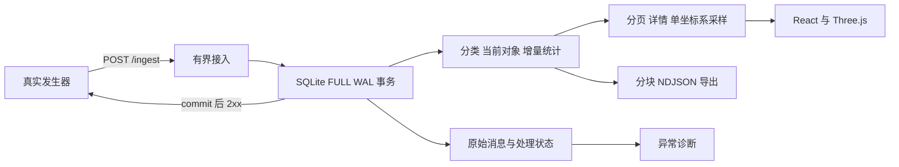

# 设计与数据语义

这套系统围绕「接收整条消息 → 可靠提交 → 组织对象 → 查询与探索 → 完整导出」构建。运行时一个 FastAPI 进程负责接口与前端静态文件，SQLite 存放原始消息和可查询视图；发生器独立运行。

## 消息、观测、对象

三个数量分别表示不同含义：HTTP 投递可能重试；业务消息由运行与消息键定位；当前对象按运行与对象 ID 唯一。一次投递包含多个对象，一个对象也可能在多条消息中出现。

消息先规范化 JSON，再计算 SHA-256 判断语义相同的重投。相同键、相同内容不重复投影；相同键、不同内容记录冲突。原始请求体仍然保存，规范化只用于去重。对象原始 JSON 完整保留，包含未识别的扩展字段与动态属性；列表只读取固定摘要列。详情采用 `{object, meta}` 信封，系统元数据不覆盖任何原始字段。

真实样本未证明同对象的更新版本规则。因此，对同 ID 不同内容采用保守的整批隔离，并给出原因，旧对象维持不变。`sequence` 作为原始字段保存，不充当版本号。这条规则避免在不了解数据语义时悄悄覆盖观测。

## 提交与隔离

一条消息的原始体、处理状态、去重信息与有效业务投影在同一事务提交，之后才返回 2xx。异常批次可整条可靠保存并标为 quarantined；这种确认表示已保存，不表示已进入当前世界。指标分别展示接收、有效入库、重复、隔离与冲突。

业务投影使用事务内的回滚边界：若某一个对象或某一次分类修改不合法，整批业务改动回滚，留下完整原始消息与错误原因。过载、体积超限和空间不足明确返回非 2xx。单写入通道、有界请求量和 SQLite busy timeout 避免无限内存排队。

## 分类与空间

分类支持真实观察到的 create、rename、move，要求 revision 连续，验证父节点与循环。缺口和未知操作可见地隔离。当前树决定当前子树筛选；原始消息中的 tree_revision 保留用于审计。当前实现不提供历史树回放，也不自动重放隔离的版本缺口。

一个点云只包含同一 `frame_id / frame_kind / unit`。展示布局拉近星群、增强 Z 轴纵深，并按视口宽高展开星点。每个可选星点保留对象 ID，详情与导出保留原始 XYZ；空间测量使用原始坐标。图层默认显示最多 3,000 个对象，背景星云用于装饰。无坐标对象仍能分类、检索、查看详情与导出。

## 有限资源下的读写

SQLite WAL 允许读取与单个写事务并行，`synchronous=FULL` 是确认可靠落盘的基础。持久卷与宿主机文件系统仍参与持久性保证；进程 SIGKILL 验证不等于宿主断电或存储故障验证。

固定字段围绕运行、对象 ID、名称前缀、分类、坐标系与游标查询建索引。动态属性保留 JSON，避免按未知字段无限建列或建索引。列表使用稳定行号游标，长属性仅在详情读取。

导出固定开始时的最大行号，分类后代集合也在开始时确定；分块短查询（至多 200 行且约 1 MiB；超过 1 MiB 的单个对象独立输出，受 8 MiB 请求上限约束），不让新入库对象无限延长导出。限制导出并发，避免慢客户端长时间占有数据库读事务和钉住 WAL。

应用数据目录的容量阈值为 18 GiB，统计数据库、WAL、SHM 和应用日志，为 20 GiB 总预算中的镜像、Docker 日志与事务增长预留空间。接近阈值时停止接收新数据，历史数据由用户归档管理。严格磁盘上限由部署平台的文件系统配额设置，资源统计范围见 [功能与资源验收](validation.md)。

## 两小时题目的取舍

采用单应用与 SQLite，省去独立消息队列、缓存与搜索引擎的资源和集成开销。没有账号系统、聊天助手、任意属性全文检索和历史时间旅行。Three.js 负责有限真实样本的探索，全量数据通过分页与流式导出访问。

完整接口见 [API.md](API.md)；实际结果与容量边界见 README 和 evidence/ 中的机器可读收据。
